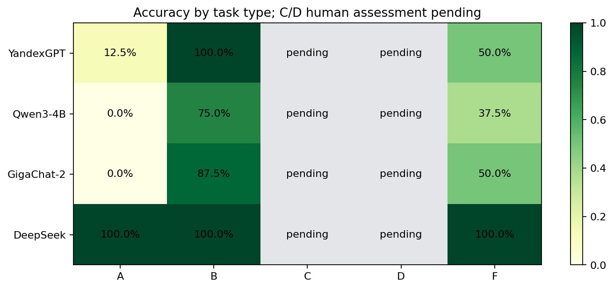
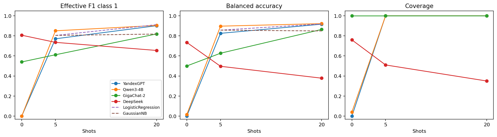
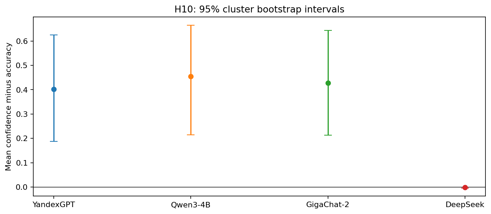
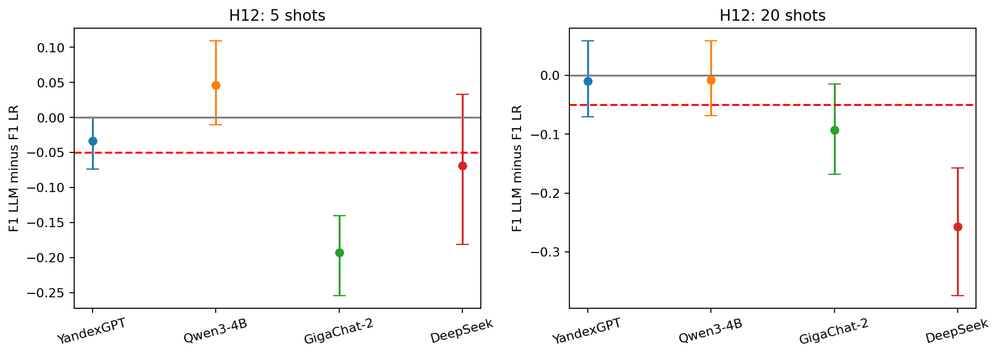
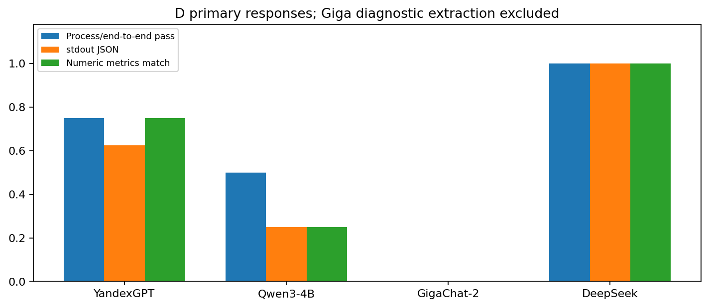

# Подготовка к защите лабораторной работы 3

Этот материал нужен, чтобы понимать эксперимент и объяснять его своими словами. Это личное учебное пособие по фактическим данным команды, а не текст, который следует сдавать как собственные выводы без проверки. Здесь объясняются результаты четырёх моделей, устройство проверок, статистика, причины наблюдаемых ошибок и границы выводов. Основной демонстрационный файл — `notebooks/defense.ipynb`; разделы в нём пронумерованы.

Главное, что следует уметь объяснить: **«надёжность» зависит от задачи и от всей процедуры получения ответа**. DeepSeek безошибочно решил итоговые A/B/F, но на классификации часто потратил весь бюджет на рассуждение и не выдал класс. Qwen плохо справилась с расчётными задачами, однако при демонстрационных примерах классифицировала строки значительно лучше. GigaChat быстро отвечает и дешёв по тарифу, но уверенный ответ может быть арифметически или методологически неверным. Простая логистическая регрессия на 20 примерах остаётся сильным, воспроизводимым ориентиром.

Нельзя превратить это в универсальную фразу «модель X всегда лучше». Мы исследовали конкретный банк, конкретные режимы и один набор few-shot примеров. В репозитории не зафиксированы две заполненные независимые ручные оценки: по C/D и обоснованиям B нельзя предъявлять вымышленное согласие проверяющих или итоговую точность 39 задач.

[TOC]

## 1 Что исследовали и почему это лабораторная по ML

Вопрос работы — можно ли доверять языковой модели в задачах классического машинного обучения. Сам по себе связный ответ не доказывает знания: модель может правильно назвать формулу, неправильно выполнить арифметику, перепутать смысл регуляризации или выдать код с утечкой данных. Поэтому требовались собственные эталоны, фиксированный протокол и измеримые показатели.

Работа связывает несколько тем курса. Расчётные задачи проверяют вероятности, impurity, метрики, регрессию и геометрию SVM. Концептуальные задачи проверяют смысл алгоритмов и границы утверждений. Инженерные задачи требуют выбрать метод и схему проверки. Генерация кода позволяет проверить реализацию и методологию. Классификация строк даёт прямое сравнение LLM с обучаемыми моделями. Ловушки проверяют чувствительность к условию, а не узнавание названия задачи.

Мы не дообучали LLM. Пять или двадцать демонстрационных примеров помещались в текст запроса — это in-context learning. У логистической регрессии и GaussianNB, напротив, параметры оценивались по этим же размеченным строкам. Одинаковое число примеров обеспечивает сопоставимый доступ к демонстрациям, но не одинаковый объём предварительных знаний: LLM заранее обучена на огромных корпусах.

### Модели и роли

YandexGPT Pro 5.1 и GigaChat-2 представляют две российские модели. DeepSeek V4.1 Flash использован как зарубежная крупная модель через Yandex AI Studio. Qwen3-4B — маленькая локальная модель с официальными весами GGUF, Q4_K_M, исполняемая через llama-cpp-python на RTX 4080 SUPER. У GigaChat сервер вернул `GigaChat-2:2.0.28.2`. У облачных URI может оставаться имя семейства/версии сервиса, а не неизменяемый hash всех весов; нельзя приписывать провайдеру не сообщённую точную сборку.

Для Qwen записана ревизия Hugging Face `bc640142c66e1fdd12af0bd68f40445458f3869b` и SHA256 файла весов `7485fe6f11af29433bc51cab58009521f205840f5b4ae3a32fa7f92e8534fdf5`. Hash идентифицирует конкретный файл, а не измеряет качество модели. Квантование уменьшает объём весов и может менять ответы; наше сравнение не отделяет его влияние от влияния числа параметров и обучения.

## 2 Как устроен банк и сколько здесь наблюдений

В банке 40 записей: A8, B8, C7, D8, F8 и E01. Тип E — протокол, а не один бинарно оцениваемый вопрос. Он разворачивается в 100 общих тестовых строк для каждого из трёх режимов 0/5/20-shot. Следовательно, на одну модель приходится 39 обычных задач + 300 строк классификации + 5 пилотных запросов = 344 сохранённых ответа. Четыре модели дают 1376 ответов. После исключения 20 pilot остаётся 1356 основных запросов.

Это число не следует использовать как единый знаменатель качества. Тогда классификация подавит остальные типы, а смысл «одной ошибки» станет неодинаковым. Основная автоматически проверяемая точность банка относится к 24 задачам A+B+F на модель. B здесь означает правильность вердикта, не полноценность обоснования. C и методология D требуют ручной оценки. E анализируется на 100 строках отдельно для каждого режима.

Именно поэтому таблица с пустыми C/D честнее полностью заполненной тепловой карты, в которой ассистент сам себе выставил оценки. Отсутствующая оценка и ошибочный ответ — разные состояния. Пустота означает «не проверено», ноль — «проверено и неверно».

Пилотные P01–P05 нужны для соединения, формата и обработки ответа. Они не входят в итог. У Qwen и Giga по одному ответу пилота не соответствовали формату ожидаемого ответа. Они сохранены без повторной генерации, параметры не оптимизировались на основном банке. Это нужно раскрывать, а не рассказывать, что формат был идеальным у всех моделей.

## 3 Как показать что запуски действительно были

Первый шаг на защите — раздел 2 блокнота. Он проверяет не одну сводную таблицу, а цепочку данных. В `events.jsonl` есть started с исходным payload и response с необработанным ответом провайдера, временем UTC, токенами, задержкой и идентификатором запроса. Сопоставляется каждый ID, проверяется число уникальных ответов и порядок времени. Затем payload сверяется с заново подготовленными запросами общего банка.

В Yandex/Giga/DeepSeek сетевой запрос и формат ответа различаются по API, поэтому идентификаторы запросов между провайдерами не обязаны совпадать. Проверяется смысловая идентичность: ровно тот же system, тот же user, температура 0 и верхний лимит 4096. Для Giga текст находится в messages, для Yandex/DeepSeek — в instructions/input. Эталоны, тестовые метки и история решения соседних задач туда не добавлялись. row_id остаётся техническим ключом журнала, а не входным признаком модели.

Отдельно проверяются SHA256 входных файлов по замороженному `source_manifest.json`. Он создан при подготовке единого комплекта из зафиксированного main и не пересоздаётся при Run All. Если изменить журнал после замораживания, проверка должна упасть, а не молча принять новую версию. Окончания строк CRLF/LF нормализованы, потому что Git на Windows может менять их при checkout; содержимое текста этим не исправляется.

Регистрационный commit извлекается из `registration_commit.txt`, затем через Git читается именно та версия файла прогнозов и сравнивается с текущей. Время commit сопоставляется с первым started основного банка, то есть до отправки main-запроса, а не только до получения ответа. Это показывает, что критерии не были переписаны после получения основных результатов в сохранённой истории. Это не означает, что все прогнозы делались до просмотра любых данных команды: у поздних моделей результаты Yandex/Qwen и classical baseline уже были известны. Такое раскрытие есть в регистрации.

| Модель | Ответов | Started | Неопределённых попыток | Разрешённых повторов | Commit прогнозов |
| --- | --- | --- | --- | --- | --- |
| YandexGPT | 344 | 346 | 2 | 2 | ad4612fb |
| Qwen3-4B | 344 | 344 | 0 | 0 | 16950bcd |
| GigaChat-2 | 344 | 344 | 0 | 0 | 9b810f09 |
| DeepSeek | 344 | 363 | 19 | 19 | 0cac26cc |

### Почему число сетевых попыток больше числа ответов

Yandex имеет две попытки с неопределённым сетевым исходом, DeepSeek — девятнадцать. Для повторов сохранены отдельные retry_authorized. Повторная передача после сетевого обрыва не означает, что выбрали лучший из нескольких содержательных ответов: до повтора ответ не был надёжно получен. Возможная стоимость первой попытки остаётся резервом. У Qwen/Giga по 344 started и response без таких повторов.

В DeepSeek есть также события изменения бюджета и работы watchdog. Изменение финансового предела с 300 до 600 рублей не меняет модельный лимит 4096 токенов. Это разные «бюджеты»: один ограничивает расходы клиента, другой — объём генерации. Нельзя объяснять 4096-token incomplete увеличением рублёвого лимита.

### Что эти доказательства не могут доказать

Локальные hashes доказывают неизменность относительно выбранного снимка и внутреннюю согласованность файлов. Они не доказывают внешнее происхождение текста математически: человек, контролирующий все файлы и историю Git, может создать согласованный набор. Журналы API не подписаны провайдером. Для независимого внешнего подтверждения можно открыть статистику использования или Billing в кабинете, сопоставить даты/токены и показать диагностический live-запрос.

В блокноте предусмотрена выключенная по умолчанию ячейка live-проверки. Она читает ключ только из локального окружения и пишет ответ в отдельную папку, не изменяя первоначальные оценки. Она доказывает работоспособность подключения сейчас, а не исторический ответ сама по себе. Не следует выдавать новый запрос за повторение прошлого: провайдер, инфраструктура и sampling могут меняться.

Для демонстрации обычно достаточно выбрать DeepSeek/A03, показать исходный started и provider output, затем переключить на DeepSeek/E01/20-shot/bc_007. У второго видно `incomplete_details.reason=max_output_tokens`, 4096 output и 4096 reasoning tokens. Это сильнее подтверждает реальный экспериментальный процесс, чем аккуратная таблица без исходных данных.

## 4 Воспроизводимость и одинаковость условий

Воспроизводимость имеет несколько уровней. Первый — из сохранённых ответов получить те же метрики; это обеспечивает Run All без сети. Второй — повторить обучение baseline на тех же строках; блокнот проверяет совпадение каждого предсказания с исходным CSV. Третий — повторить обращение к LLM и получить побитово тот же текст. Для облачных моделей третий уровень не гарантирован даже при temperature=0.

Температура 0 обычно задаёт жадный или близкий к детерминированному выбор, но провайдер может иначе интерпретировать параметр. Облачная сборка может обновляться; параллельная арифметика и GPU kernels могут иметь недетерминированность; близкие logits чувствительны к округлению. Поэтому записываются запрошенные и сообщённые параметры, точные доступные ID, даты, usage и сами ответы. У Giga effective temperature не сообщён и оставлен null, а не объявлен равным 0 без доказательств.

Равные 4096 выходных токенов не означают равное число видимых слов. У DeepSeek reasoning tokens входят в output_tokens. Если рассуждение заняло всё окно, итоговый JSON не успевает появиться. У Qwen выбран режим без рассуждений через шаблон с пустым think-блоком. Поэтому различия качества нельзя причинно приписать только размеру модели или стране происхождения.

Промпт не следует подбирать на основных тестах. Иначе происходит аналог подгонки гиперпараметров под test: результат отражает адаптацию к конкретному банку. Пилот отделён именно для этого. Повторный неверный содержательный ответ ради более удобного варианта также нарушил бы pass@1. В сохранённых основных прогонах такие ответы не выбирались повторно.

## 5 Как проверяются эталоны и что нужно знать по формулам

В разделе 4 блокнота восемь ответов A заново вычисляются простыми формулами. Эта ячейка полезна на защите: она показывает, что эталон не просто взят из другой LLM. Стоит уметь объяснить хотя бы A01, A02, A03 и A04 без кода.

**Байес A01.** Событие D — дефект, «+» — срабатывание. P(D|+) = P(+|D)P(D) / [P(+|D)P(D)+P(+|не D)P(не D)]. Для 2%, 96%, 4% это 0.0192/(0.0192+0.0392)=24/73≈0.328767. Ошибка — отвечать 0.96 как чувствительностью или 0.02 как априорной вероятностью. Условная вероятность после положительного теста отличается от обеих.

**Джини A02.** G=1−Σp_k². У родителя (36,24) G=0.48. Слева (30,6) G=5/18, справа (6,18) G=3/8. Взвешивать нужно размерами детей 36/60 и 24/60. Прирост 0.48−0.6·5/18−0.4·3/8=0.1633333. Если использовать в дочерних долях знаменатель 60 вместо размера соответствующего узла, получается другая величина.

**F1 A03.** Precision=42/(42+18)=0.7, recall=42/(42+14)=0.75. F1=2PR/(P+R)=2TP/(2TP+FP+FN)=84/116=21/29≈0.7241379. Гармоническое среднее не равно арифметическому (0.725). TN не входит в F1 положительного класса. Accuracy здесь (42+126)/200=0.84 — ещё один другой показатель.

**МНК A04.** Для свободного члена b=Σ(x−x̄)(y−ȳ)/Σ(x−x̄)². x̄=1.5, ȳ=2.5; числитель 6, знаменатель 5, b=1.2. Фиксация intercept в нуле изменила бы задачу. Формула с сырыми суммами эквивалентна, но нельзя ошибаться в Σy и Σxy.

**Логистическая регрессия A05.** z=−0.4+0.6·2−0.2·1=0.6; sigmoid(z)=1/(1+exp(−z))≈0.645656. Здесь просят вероятность, а не пороговый класс. Даже корректно названная sigmoid не спасает ошибку в линейной комбинации.

**kNN A06.** k=3 при трёх обучающих объектах означает использование всех объектов. Метки 0,1,1 дают класс 1 при равных весах. Ближайшая одна точка имеет класс 0, но это не 1-NN. Расстояния не меняют число голосов при uniform weights, если все три уже выбраны.

**SVM A07.** Границы w·x+b=±1 находятся друг от друга на 2/||w||. Для (6,8) норма 10, полная ширина 0.2. Половина зазора равна 0.1. Формула требует канонической нормировки; произвольное масштабирование w,b без сохранения уровней ±1 изменяет смысл.

**PCA A08.** Собственные значения 4,3,1 дают общую дисперсию 8; первые два направления — 7/8=0.875. PCA не использует метки классов. Объяснённая дисперсия и сохранение разделимости классов — разные свойства.

Численный ответ допускается, если |answer−reference| ≤ absolute + relative·|reference|. В банке обычно relative=0.01. Это относительный допуск 1%, не допуск «один процентный пункт» для любой вероятности. Булевское true в Python похоже на 1, поэтому проверка специально запрещает bool как численный ответ.

## 6 Основные результаты на A B F

| Модель | A | B вердикт | F | A+B+F | Accuracy | 95% bootstrap CI |
| --- | --- | --- | --- | --- | --- | --- |
| YandexGPT | 1/8 | 8/8 | 4/8 | 13/24 | 54.2% | [33.3%; 75.0%] |
| Qwen3-4B | 0/8 | 6/8 | 3/8 | 9/24 | 37.5% | [16.7%; 58.3%] |
| GigaChat-2 | 0/8 | 7/8 | 4/8 | 11/24 | 45.8% | [25.0%; 66.7%] |
| DeepSeek | 8/8 | 8/8 | 8/8 | 24/24 | 100.0% | [100.0%; 100.0%] |

DeepSeek имеет 24/24 верных итоговых ответов на этой подвыборке. Yandex — 13/24, Giga — 11/24, Qwen — 9/24. Все три последних имеют слабые результаты на A, хотя многие объяснения называют правильные формулы. Это измеренное расхождение между текстовым знанием формулы и правильностью выдаваемого результата.

По B вердикты заметно лучше расчётов. Но автоматическая оценка не проверяет всю причинную аргументацию. Например, Qwen в B08 правильно признаёт возможность локального минимума KMeans, но называет используемую процедуру градиентным спуском. Обычный Lloyd чередует назначение ближайших центров и пересчёт средних; верный boolean не делает такое объяснение безупречным. Именно для этого в задании есть отдельная рубрика 0–2.

Результаты F не являются полноценным тестом «запоминание против рассуждения»: связанных пар мало, и H1 не входит в выбранные три гипотезы. Разобрать пары как иллюстрации можно, но нельзя задним числом объявить новый подтверждённый научный результат.

### Почему нельзя сказать DeepSeek гарантирует 100 процентов

Bootstrap многократно выбирает элементы уже наблюдавшегося вектора. Если там 24 единицы, любой повтор даёт среднее 1. Поэтому получаем [1;1]. В этой выборке нет наблюдаемой ошибки, которую bootstrap мог бы размножить. Это свойство метода, не уверенность в истинной популяционной точности. Как дополнительную иллюстрацию можно использовать правило трёх: при 0 ошибках из 24 грубая верхняя 95%-граница доли ошибок порядка 3/24=12.5%; это другой подход, не зарегистрированный bootstrap-результат.

Кроме того, задачи подобраны командой, а не случайно из всех возможных ML-задач; некоторые F связаны. Интервал по ресэмплам этого банка не покрывает неопределённость выбора новых тем, промптов, версий моделей и квантований. На защите правильно говорить «24 из 24 на нашем банке», а не «модель безошибочна в машинном обучении».

## 7 Классификация строк и сравнение с обучаемыми моделями

Dataset — sklearn load_breast_cancer. Для E выбраны шесть общих числовых признаков. Test содержит 100 строк: 63 класса 0 и 37 класса 1. В E 1=malignant, 0=benign; это обратно исходному sklearn target. Демонстрации train5 содержат 3 нуля и 2 единицы, train20 — 13 нулей и 7 единиц. Train5 вложен в train20, а train20 не пересекается с test.

LR обучается после StandardScaler только по имеющимся 5/20 строкам. Тест не участвует в fit scaler, подборе параметров или выборе порога. Воспроизведение сравнивает каждое предсказание по row_id, а не только округлённый F1: одинаковый общий показатель ещё мог бы скрыть перестановку строк. GaussianNB исходного baseline работает без масштабирования. Добавление scaler меняет влияние var_smoothing и на этом наборе не воспроизводит исходный CSV, поэтому менять его молча нельзя.

| Baseline | Train | F1 класса 1 | BA | Accuracy |
| --- | --- | --- | --- | --- |
| LogisticRegression | 5 | 0.8043 | 0.8571 | 0.8200 |
| GaussianNB | 5 | 0.8043 | 0.8571 | 0.8200 |
| LogisticRegression | 20 | 0.9118 | 0.9189 | 0.9400 |
| GaussianNB | 20 | 0.8182 | 0.8490 | 0.8800 |

| Модель | Shots | F1 класса 1 | BA | Accuracy всех | Coverage | Accuracy отвеченных |
| --- | --- | --- | --- | --- | --- | --- |
| YandexGPT | 0 | 0.0000 | 0.0000 | 0.0% | 0.0% | не определена |
| YandexGPT | 5 | 0.7708 | 0.8254 | 78.0% | 100.0% | 78.0% |
| YandexGPT | 20 | 0.9014 | 0.9166 | 93.0% | 100.0% | 93.0% |
| Qwen3-4B | 0 | 0.0000 | 0.0159 | 2.0% | 4.0% | 50.0% |
| Qwen3-4B | 5 | 0.8506 | 0.8968 | 87.0% | 100.0% | 87.0% |
| Qwen3-4B | 20 | 0.9041 | 0.9221 | 93.0% | 100.0% | 93.0% |
| GigaChat-2 | 0 | 0.5401 | 0.5000 | 37.0% | 100.0% | 37.0% |
| GigaChat-2 | 5 | 0.6116 | 0.6270 | 53.0% | 100.0% | 53.0% |
| GigaChat-2 | 20 | 0.8193 | 0.8642 | 85.0% | 100.0% | 85.0% |
| DeepSeek | 0 | 0.8065 | 0.7347 | 75.0% | 76.0% | 98.7% |
| DeepSeek | 5 | 0.7353 | 0.4966 | 45.0% | 51.0% | 88.2% |
| DeepSeek | 20 | 0.6545 | 0.3782 | 35.0% | 35.0% | 100.0% |

### Как читать zero shot

Yandex во всех 100 строках ответил insufficient_data; это отказы, а не 100 предсказаний нуля. Qwen тоже отказалась в 96 случаях, четыре ответа соответствовали классовому формату. Giga выдала единицу всем ста строкам. Поэтому её zero-shot recall положительного класса равен 1, precision=0.37, F1=2·0.37/(1+0.37)≈0.5401, но recall класса 0 равен 0, balanced accuracy=(1+0)/2=0.5. Модель не разделяет классы, несмотря на ненулевой и на вид неплохой F1.

Константа «всегда 0» имеет accuracy=0.63, BA=0.5, F1 редкого класса=0. Эти две константы показывают, почему одна метрика может поощрять примитивное поведение. F1 важен для положительного класса, BA сравнивает распознавание обоих классов, confusion показывает конкретные типы ошибок. Выбор основной метрики должен быть определён заранее, а не меняться под победителя.

DeepSeek в zero-shot дал 76 допустимых ответов. На ответившем подмножестве он точен почти на 99%, но на всех 100 строках accuracy=0.75. Удаление 24 незавершённых запросов означало бы изменение задачи оценки.

### Почему DeepSeek при большем числе примеров выглядит хуже

Coverage DeepSeek падает с 76% до 51% и 35%. Среди 35 ответов 20-shot все 35 правильны: 18 положительных и 17 отрицательных. Ещё 65 запросов incomplete. Поэтому условная accuracy равна 1, полная accuracy=0.35. Полная BA=(18/37+17/63)/2≈0.3782. В таком режиме высокая точность на выбранном самим процессом подмножестве не обеспечивает требуемую надёжность на всех входах.

В сохранённом примере bc_007 все 4096 output tokens являются reasoning tokens; итогового класса нет. Наблюдение прямо подтверждается metadata. Обоснованное объяснение: установленного бюджета оказалось недостаточно для завершения некоторых рассуждений. Гипотеза, что few-shot ухудшает собственно распознавание или что модель «разучилась», этими данными не подтверждается: главным измеренным изменением является доля завершений.

Больше примеров делает запрос длиннее, но недостаточно сказать «не хватило входного контекста». В ответе причина — max_output_tokens, а не отказ входного контекста. Не следует путать input length, output budget и денежный лимит. Можно предложить отдельный будущий эксперимент с другим reasoning/output budget или режимом, но нельзя выдавать его ожидаемый результат за уже измеренный.

### Что именно считается ошибкой при отказе

В таблицах -1 означает отсутствие допустимого предсказания. Для accuracy любой -1 не совпадает с истинным 0/1. В BA отказ уменьшает recall своего истинного класса. Для F1 класса 1 отказ на положительной строке даёт FN, но отказ на отрицательной не является FP. Поэтому F1 не штрафует отсутствие ответа на отрицательных строках тем же способом, что полная accuracy. Это ещё одна причина обязательно показывать coverage и матрицу 2×3.

В DeepSeek 20-shot F1=36/(36+19)=0.6545: TP=18, FP=0, FN=19 (37 положительных минус 18 верных). Одновременно BA ниже 0.5 и accuracy=0.35. Противоречия нет: метрики измеряют разные аспекты, а F1 не включает TN. Нельзя сравнивать F1=0.6545 с accuracy константы 0.63 и объявлять победу — это разные шкалы.

### Что можно сказать о Qwen и LR

Qwen при 5-shot имеет F1≈0.8506, LR≈0.8043; при 20-shot Qwen≈0.9041, LR≈0.9118. Это делает локальную модель конкурентной в данной постановке. Но 100 test-строк и один набор демонстраций не позволяют доказать универсальное преимущество. Изменение train5 может сильно сдвинуть обе оценки. Результат также условен на публичный датасет: часть строк или его закономерностей могла встречаться при обучении LLM.

Классическая модель не имеет корректного zero-shot режима без обучения. Нельзя поставить LR zero-shot=0 и построить фиктивную кривую, будто это измеренное качество. Отсутствующий режим обозначается как неприменимый. При 5/20 обеим сторонам доступны одинаковые шесть признаков и те же размеченные строки, хотя их предварительные знания различаются.

## 8 Статистика различий между моделями

Для двух моделей на одних задачах нужен парный анализ. Если A и B обе правы или обе ошиблись, такой объект не говорит о направлении различия. Exact McNemar использует b — задачи, где права только первая, и c — где права только вторая. При нулевой гипотезе на discordant задачах направление равновероятно; двусторонний binomial test проверяет отклонение от 0.5.

| Первая | Вторая | Только первая верна | Только вторая верна | Exact p | Holm p | p Holm < 0.05 |
| --- | --- | --- | --- | --- | --- | --- |
| YandexGPT | Qwen3-4B | 4 | 0 | 0.125 | 0.375 | нет |
| YandexGPT | GigaChat-2 | 2 | 0 | 0.5 | 1 | нет |
| YandexGPT | DeepSeek | 0 | 11 | 0.000976562 | 0.00390625 | да |
| Qwen3-4B | GigaChat-2 | 0 | 2 | 0.5 | 1 | нет |
| Qwen3-4B | DeepSeek | 0 | 15 | 6.10352e-05 | 0.000366211 | да |
| GigaChat-2 | DeepSeek | 0 | 13 | 0.000244141 | 0.0012207 | да |

В полном семействе из шести сравнений DeepSeek превосходит каждую из остальных моделей по этой 24-задачной автоматической оценке с p_Holm<0.05. Между Yandex, Giga и Qwen значимых различий не обнаружено. Это не доказывает равенство трёх моделей: выборка может быть слишком мала. Также это не утверждение о C, методологии D или классификации E.

Holm: упорядочиваем шесть p по возрастанию, умножаем первое на 6, второе на 5 и так далее, ограничиваем 1 и обеспечиваем неубывание накопленным максимумом. Поправка защищает от случайных находок из-за числа сравнений. Она не исправляет плохую разметку, выбор удобного банка или зависимость задач. В частности, F-пары требуют осторожной интерпретации обычного McNemar. Результат разумно предъявлять как исследовательский на этом банке, а не как окончательное доказательство превосходства архитектуры.

Доверительные интервалы отдельных accuracy и тест McNemar отвечают на разные вопросы. Пересечение двух отдельных CI не является корректным универсальным тестом равенства двух парных результатов. Нужно анализировать совместные ошибки на одних задачах. Аналогично разность двух метрик на E следует bootstrap-ить парно: выбирать одни и те же row_id для обеих моделей.

## 9 Три заранее выбранные гипотезы

Прогноз команды был confirm для H5, H10 и H12. Прогноз не является результатом; аккуратно опровергнутая гипотеза нормальна для исследовательской работы. Сохранение критериев до основного запуска защищает от подбора определения «успеха» по итоговой таблице.

### H5 Маленькая модель сильнее отстаёт в расчётах чем в концепциях

Основная пара заранее выбрана: Yandex против Qwen. Разрыв на A равен 0.125−0=0.125; на B — 1−0.75=0.25. Статистика gap_A−gap_B=−0.125. Если H5 ожидалась, направление должно быть положительным; наблюдаемое направление обратное. Но 95%-интервал [−0.5;0.25] пересекает ноль, поэтому зарегистрированный статус — insufficient_data.

Нельзя написать, что H5 подтверждена, потому что Qwen хуже Yandex «вообще». Она утверждает конкретное различие двух разрывов. Нельзя и заменить Yandex на DeepSeek после просмотра данных: это поменяло бы первичную гипотезу. Дополнительную пару можно показать как вторичный исследовательский расчёт, с отдельной маркировкой.

Размер не изолирован: Qwen отличается обучением, квантованием, inference backend и режимом рассуждений. Даже положительная статистика не доказала бы, что причиной является только число параметров. Для причинного исследования нужны близкие семейства моделей разных размеров и одинаковые режимы, по возможности без других изменений.

### H10 Модели завышают уверенность

Проверяется A+B+F. Для разбираемых ответов берётся confidence/100 и бинарная правильность; signed gap — их средняя разность. Если нижняя 95%-граница выше 0, фиксируется confirm; если верхняя ≤0 — reject; иначе insufficient_data. Coverage и accuracy на полном знаменателе показываются рядом, чтобы не скрыть отсутствующие confidence.

| Модель | n valid / 24 | Mean confidence | Accuracy valid | Gap | 95% CI gap | ECE | Статус |
| --- | --- | --- | --- | --- | --- | --- | --- |
| YandexGPT | 22/24 | 99.3% | 59.1% | 0.4023 | [0.1875; 0.6250] | 0.4023 | confirm |
| Qwen3-4B | 22/24 | 86.4% | 40.9% | 0.4545 | [0.2142; 0.6651] | 0.4545 | confirm |
| GigaChat-2 | 22/24 | 92.7% | 50.0% | 0.4273 | [0.2125; 0.6432] | 0.4273 | confirm |
| DeepSeek | 24/24 | 99.8% | 100.0% | -0.0021 | [-0.0041; -0.0007] | 0.0021 | reject |

Yandex, Qwen и Giga имеют положительный gap с интервалами выше нуля. У DeepSeek на 24/24 верных ответах mean confidence немного ниже 1, поэтому gap отрицателен и H10 получает reject. Не следует превращать это в вывод, что DeepSeek идеально калиброван: есть лишь маленький, почти одноуровневый набор confidence. Нет данных о его поведении при уверенности 0.2, 0.5 или на другом распределении задач.

ECE — взвешенное среднее |confidence−accuracy| по пяти bins. У него нет знака: большая ECE может означать и переуверенность, и недоуверенность. Для направления нужна signed gap. Confidence=1 включается в последний bin. Связанные варианты F bootstrap-ятся одним кластером, чтобы не считать их полностью независимыми наблюдениями.

### H12 При 5 примерах LLM не хуже LR а при 20 проигрывает

Первичная метрика — F1 редкого класса. Для 5-shot заранее введён margin 0.05: «не хуже» означает не проигрывать больше чем на пять сотых F1. Это не то же, что «тест различия незначим». Нужна нижняя односторонняя 95%-граница delta=F1_LLM−F1_LR выше −0.05. При 20-shot ожидается проигрыш: верхняя граница должна быть ниже 0.

| Модель | Shots | F1 LLM − F1 LR | Односторонние 95% границы | Часть | Вся H12 |
| --- | --- | --- | --- | --- | --- |
| YandexGPT | 5 | -0.0335 | [-0.0740; 0.0004] | insufficient_data | insufficient_data |
| YandexGPT | 20 | -0.0104 | [-0.0705; 0.0580] | insufficient_data | insufficient_data |
| Qwen3-4B | 5 | 0.0462 | [-0.0103; 0.1091] | confirm | insufficient_data |
| Qwen3-4B | 20 | -0.0077 | [-0.0683; 0.0581] | insufficient_data | insufficient_data |
| GigaChat-2 | 5 | -0.1928 | [-0.2536; -0.1397] | reject | reject |
| GigaChat-2 | 20 | -0.0925 | [-0.1680; -0.0153] | confirm | reject |
| DeepSeek | 5 | -0.0691 | [-0.1810; 0.0326] | insufficient_data | insufficient_data |
| DeepSeek | 20 | -0.2572 | [-0.3735; -0.1570] | confirm | insufficient_data |

У Qwen поддержана часть 5-shot: интервал допускает небольшое отставание, но нижняя граница выше −0.05. При 20-shot различие около −0.0077, интервал пересекает 0 — ожидаемый проигрыш не подтверждён. Общая H12 поэтому insufficient_data.

У Giga 5-shot даже верхняя граница ниже −0.05: это противоречит первой части H12. При 20-shot проигрыш LR подтверждён, но одна неверная часть достаточна для reject всей составной гипотезы. У DeepSeek часть 20-shot подтверждает эффективное отставание, а 5-shot остаётся неопределённой; общий статус insufficient_data. Причиной большого эффективного отставания DeepSeek в значительной мере являются incomplete, а не доказанное ухудшение правильности завершённых ответов.

Для H12 используются перцентили 5 и 95 как две односторонние 95%-границы. На графике это выглядит как центральный 90%-интервал; его нельзя подписывать «обычный двусторонний 95%». Отдельные метрики имеют двусторонние 95%-интервалы 2.5/97.5. Разница важна для объяснения строгих зарегистрированных критериев.

## 10 Код D и почему pass at one недостаточно

| Модель | Основной pass | stdout JSON | Числа совпали | Примечание |
| --- | --- | --- | --- | --- |
| YandexGPT | 6/8 | 5/8 | 6/8 | основной сохранённый код |
| Qwen3-4B | 4/8 | 2/8 | 2/8 | основной сохранённый код |
| GigaChat-2 | 0/8 | 0/8 | 0/8 | 6/8 извлечённых фрагментов |
| DeepSeek | 8/8 | 8/8 | 8/8 | основной сохранённый код |

Pass@1 в этой работе измеряет выполнение первой программы без ошибки процесса; для Giga добавлено требование первичного корректного формата. Процесс может успешно выполнить пустой скрипт или выражение-словарь. Поэтому рядом нужны формат stdout, численное совпадение и отдельная методологическая оценка.

Qwen D03 создаёт result, но не вызывает print. В автономном .py последнее выражение не выводится, в отличие от интерактивного Jupyter. Qwen D07 вообще возвращает строку-словарь с примерным silhouette. Такой файл может закончиться с exit code 0, но он не генерирует данные и не вычисляет кластеризацию. Это реальные примеры расхождения «программа не упала» и «задача выполнена».

В Giga все ответы D содержат JSON вместе с кодом вне корректного строкового answer либо повреждённые кавычки. По общему правилу нельзя извлечь удобный кусок и задним числом считать формат верным. Первичные D поэтому 0/8. Отдельно точные подстроки кода диагностически запущены без правок: 6/8 без runtime error, D02 и D05 имеют NameError из-за отсутствующего Pipeline. Подстроки, offsets и hashes записаны; первичные баллы не изменены.

Особенно показателен Giga D01. В коде `best_estimator_.score(X_test,y_test)` для SVC возвращает обычную accuracy. Результат подписан balanced_accuracy. Число 0.97902098 близко к эталонному BA 0.97945493 и проходит численный допуск 0.01, однако метрика названа неверно. На другом дисбалансе расхождение было бы гораздо больше. Это объясняет необходимость методологической проверки даже после совпадения чисел.

DeepSeek D01–D08 выполнились без правок и совпали с эталонами. Это сильный технический результат, но не замена двум независимым проверяющим. Нужны проверки, что scaler и PCA fit только по train, GridSearchCV не видел test, оценка проведена на holdout, выбрана нужная метрика, seed/stratify соблюдены. В D07 отсутствие holdout не ошибка: условие явно задаёт описательную кластеризацию всех 300 объектов.

## 11 Разбор конкретных ошибок

Ниже важно разделять наблюдаемую ошибку и предположение о внутреннем механизме LLM. Мы видим текст, вычисления и результат; не видим скрытые представления модели. Поэтому корректно говорить «ошибка возникает в этом переходе», а не уверенно утверждать, что модель «вспомнила не тот учебник» или «не умеет рассуждать вообще».

### Пример 1 Yandex A03

Модель правильно называет precision=0.7, recall=0.75 и получает около 0.7241, затем в том же обосновании приписывает ещё одно приближение к 0.6364 и кладёт 0.6364 в answer. Это не допустимое округление: разница велика относительно 1%-допуска. Ошибка локализуется в заключительном переходе и согласовании объяснения с итоговым полем.

Практическое следствие: корректная формула в начале ответа не гарантирует правильного финального числа. Проверяющая система должна сравнивать именно установленный answer, не выбирать из длинного объяснения наиболее удобное число. Иначе мы оценим не модельный ответ, а способность проверяющего его исправить.

### Пример 2 Qwen A06

Модель перечисляет все три соседние точки и сама пишет, что две относятся к классу 1, одна к классу 0, затем отвечает 0. Наблюдаемое объяснение содержит достаточные сведения для правильного решения, но ответ им противоречит. Не нужно придумывать сложную причину: факт — несогласованность вывода и описанного голосования.

Проверка вручную очень короткая: uniform weights, k=3, метки [0,1,1], большинство 1. Предложение «первый сосед ближе» соответствовало бы другому режиму — 1-NN или distance weighting — и не меняет заданное условие.

### Пример 3 Qwen B03

Модель считает, что отсутствие использования y делает обучение StandardScaler на train+test безопасным. Это концептуальная ошибка: утечка может идти через X. Среднее и стандартное отклонение test влияют на преобразование train и последующее обучение. Оценка перестаёт моделировать работу на действительно новых данных.

Исправление — split до fit, scaler.fit только train, test только transform. При CV scaler должен быть внутри Pipeline, иначе статистики validation-fold попадут в преобразование остальных folds. Не всякая утечка обязательно сильно повысит число на этом датасете; неверен сам протокол оценивания, даже если численная разница мала.

### Пример 4 Giga B05

Модель признаёт, что увеличение C увеличивает штраф за ошибки, но называет это более жёсткой регуляризацией. В стандартной soft-margin постановке минимизируется 0.5||w||²+C·Σξ. Большой C делает violations дороже относительно штрафа на норму: это более слабая регуляризация, больший акцент на подгонке train. Термины «штраф за нарушения» и «регуляризация сложности» нельзя отождествлять.

При объяснении полезно проговорить, какой член целевой функции усиливается. Само слово «штраф» без уточнения может создать ложную уверенность. Следствие ошибки — неверное направление настройки гиперпараметра при переобучении.

### Пример 5 F05 и математически понятная но невалидная JSON дробь

В исходном ответе встречается `2/3` непосредственно вместо числового JSON-значения. По смыслу это мог быть правильный результат для классического Monty Hall, но JSON допускает число, строку, boolean, null, массив или объект, а не выражение деления. Политика заранее запрещает вычислять выражение за модель, поэтому это invalid_json и основной неуспех.

Можно отдельно сказать «математическая идея различима, интерфейсный контракт нарушен». Нельзя молча оценить такой ответ как 0.6667, пока другим моделям засчитываются все ошибки формата. Для практического сервиса надёжный машинный формат — часть полезного результата.

### Пример 6 DeepSeek E01

Запрос с 20 демонстрациями bc_007 завершён incomplete/max_output_tokens. output_tokens=4096, reasoning_tokens=4096, итогового класса нет. Это не содержательный ответ «данных недостаточно» и не сетевой таймаут: провайдер прислал корректный объект со статусом незавершённой генерации. Он должен учитываться как отсутствие предсказания, без попытки угадать класс по промежуточному reasoning.

Следствие: контроль над длиной/режимом рассуждения может быть столь же важен, как способность модели решать задачу. Отдельный инженерный эксперимент мог бы изменить reasoning budget, формат или fallback на классический классификатор. В этой лабораторной параметры зафиксированы и ответы не дописывались.

### Пример 7 Qwen D06

Код вычисляет `np.corrcoef(y_test,y_pred)[0,1]` и называет это r2, а затем падает при `json.dumps(...,separators=',')`, потому что separators ожидает пару разделителей. Здесь две разные проблемы: runtime ошибка сериализации и неверная формула метрики. Даже если исправить последний вызов, корреляция не станет коэффициентом детерминации. Первичный pass@1 не разрешает ни одной правки.

Правильный R²=1−Σ(y−ŷ)²/Σ(y−ȳ)². Корреляция измеряет линейную связь, не штрафует систематическое смещение и масштаб так, как R² прогноза. Это полезный пример, почему запуск после исправления синтаксиса ещё не завершает проверку ML-кода.

### Пример 8 F06 отличается от классического Monty Hall

Ведущий не знает, где приз, и случайно открывает одну из двух других дверей. Мы условились на то, что открылась коза. Если машина за выбранной дверью, коза откроется с вероятностью 1; если за другой — с вероятностью 1/2. После условливания вероятность машины за выбранной дверью становится 1/2, и переключение тоже выигрывает с 1/2. Классическое 2/3 требует знающего ведущего, который гарантированно открывает козу.

Этот пример показывает, зачем внимательно читать механизм отбора событий. Важно не узнавать название задачи, а выписать условные вероятности. Даже правильный ответ на F05 не переносится автоматически на изменённое условие F06.

## 12 Цена скорость токены и память

| Модель | Цена A/B/F руб | Верных A/B/F | Руб за верный A/B/F | Цена всех 344 руб | Резерв сети руб | Mean latency с |
| --- | --- | --- | --- | --- | --- | --- |
| YandexGPT | 7.3744 | 13 | 0.5673 | 248.4592 | 17.9984 | 20.18 |
| Qwen3-4B | 0.0000 | 9 | 0.0000 | 0.0000 | 0.0000 | 0.99 |
| GigaChat-2 | 0.2684 | 11 | 0.0244 | 3.9534 | 0.0000 | 0.73 |
| DeepSeek | 3.5000 | 24 | 0.1458 | 437.2283 | 87.7508 | 44.52 |

Цена одного правильного ответа считается на одинаковом наборе A/B/F: цена всех 24 запросов делится на число верных. Ошибочные запросы тоже стоят денег и входят в числитель. Нельзя делить стоимость только верных запросов на число верных и забыть затраты неудачных. Для Qwen 0 в API-колонке означает отсутствие API-тарификации, а не бесплатное электричество, видеокарту или труд.

Сравнение всей стоимости 344 вызовов отвечает другому вопросу. DeepSeek на A/B/F дешевле Yandex по тарифному эквиваленту, но весь прогон дороже из-за длительной классификации и reasoning. Это пример того, как стоимость задачи зависит от поведения модели, а не только от прайса за тысячу токенов.

У Giga 60 822 тарифицируемых токена и 256 174 бесплатных cached input tokens. Нельзя сравнить 60 822 с полным числом токенов другой модели и объявить, что её запросы в пять раз короче. prompt_tokens в Giga уже исключает кэш, total_tokens — тарифицируемый итог. В DeepSeek reasoning включён в output_tokens и не прибавляется второй раз.

Расчётная цена Giga по опубликованному пакету Lite — 3.95343 рубля за использованный объём. Фактических покупок не было, использована freemium-квота. Уменьшение остатка квоты точно равно 60 822. Для Yandex/DeepSeek тарифный расчёт usage не является выгрузкой фактических банковских списаний. Резервы 17.9984 и 87.7508 рублей за сетевые неопределённости нельзя выдавать за подтверждённый расход.

Средняя latency вычислена по основным 339 ответам без pilot; retries и ожидание backoff не полностью превращаются в задержку успешного ответа. Загрузка весов Qwen не включена в время одной генерации. Поэтому это характеристика зафиксированных запусков, а не точная задержка всей пользовательской сессии и не чистый benchmark архитектур.

Qwen работала на RTX 4080 SUPER с примерно 16 GiB VRAM. В мониторинге классификации sampled peak RSS процесса около 3.02 GiB, used VRAM всего устройства 5458 MiB. VRAM включает рабочий стол и другие процессы; это не выделенная память только модели. Измерения с интервалом около секунды могли пропустить короткий пик. Pilot/main были до этой выборки мониторинга. На защите лучше назвать границы измерения, чем выдавать цифру за точный универсальный минимум памяти.

## 13 Ограничения и что из них следует

**Малый и выбранный банк.** По восемь задач на тип, часть знакомых формулировок, несколько зависимых пар. Следствие: выводы относятся прежде всего к этому набору. Нужен более широкий независимый банк для уверенного обобщения.

**Публичный датасет.** Breast cancer давно известен, мог попасть в pretraining. Мы не можем отличить использование общих знаний от запоминания конкретных строк. Следствие: не следует считать это доказательством переноса на новый промышленный датасет. Для нового исследования нужен закрытый holdout или новые данные.

**Один набор few-shot.** Bootstrap test-строк не меняет демонстрации. Следствие: интервалы не оценивают вариативность выбора train5/train20. Нужны несколько заранее выбранных наборов демонстраций и скоординированные train/test splits.

**Режимы и лимиты.** Разные reasoning defaults, квантование, backend и токенизаторы. Следствие: мы сравниваем доступные конфигурации, не причинный эффект размера или национальности модели. Изменение режима потребует нового зарегистрированного эксперимента.

**Формат как часть оценки.** Некоторые математически осмысленные ответы потеряны из-за JSON. Следствие: основные числа измеряют надёжность полного контракта. Диагностика содержания полезна, но должна быть явно вторичной и не подменять основной знаменатель.

**Ручная оценка незавершена.** Нельзя объединить C/D с A/B/F в финальную accuracy или заявить kappa без двух реальных оценок. Предварительное замечание ассистента не создаёт независимость проверяющих.

**Не все источники неопределённости покрыты.** Есть обновления API, сетевые события, backend nondeterminism, состав банка и несовпадение стоимости времени/железа. Следствие: аккуратно хранить сырые ответы и не интерпретировать любой узкий CI как полную уверенность.

## 14 Практические рекомендации которые можно обосновать

| Задача | Рекомендация в границах опыта | Обоснование |
|---|---|---|
| Числовой расчёт | Проверять формулой или исполняемым вычислением | Три модели ошибались даже при правильной формуле; DeepSeek без ошибок только на данном банке |
| Концептуальное утверждение | Использовать как черновое объяснение и проверять ключевую причинную связь | Верный boolean не гарантирует корректности всего explanation |
| Выбор метода | Проверять данные, ограничения и схему валидации человеком | Без этого можно предложить правильное название алгоритма с неверным экспериментом |
| Код sklearn | Отдельно проверять исполнение, stdout, числа и методологию | D01 Giga и D07 Qwen показывают разные виды ложного успеха |
| Табличная классификация | Сначала сравнивать с LR/NB и константой | LR20 даёт сильный F1 без риска незавершённой генерации |
| Уверенность | Не считать её достаточным сигналом доверия | H10 подтверждена для трёх моделей на A/B/F |
| Длинные рассуждения | Следить за coverage и лимитами, предусматривать отдельный fallback | DeepSeek20 завершил только 35 из 100 классификаций |

Эта таблица — интерпретация данных для подготовки, а не универсальная инструкция внедрения. В реальном проекте потребуются свежие данные, критерии допустимой ошибки, стоимость ошибок и проверка на целевом распределении. Гипотетическую будущую экономию из этой лабораторной посчитать нельзя.

## 15 Сценарий пятиминутной защиты

**Первая минута.** Объяснить цель, четыре модели и структуру банка. Назвать правильные знаменатели: 344 ответа на модель, 5 pilot исключены, A/B/F — 24 задачи, E — отдельно 100×3. Показать таблицу аудита и один исходный запрос. Уточнить, что журналы и commits проверяются офлайн, ключей в блокноте нет.

**Вторая минута.** Показать heatmap и accuracy CI. Сказать: DeepSeek 24/24 A/B/F, остальные 13/24, 11/24, 9/24; у C/D нет фиктивных человеческих баллов. Открыть A03: formula и answer могут противоречить. Показать, что эталон вычисляется в отдельной ячейке.

**Третья минута.** Перейти к E и графику coverage. Показать DeepSeek20: 35% coverage при 100% conditional accuracy. Объяснить max_output_tokens и reasoning. Сравнить Qwen и LR: конкурентный 5-shot, близкий 20-shot, но не универсальное превосходство.

**Четвёртая минута.** Назвать результаты H5/H10/H12 и ключевой смысл статистики. H5 insufficient, H10 зависит от модели, H12 Giga reject, другие insufficient. Показать точный McNemar с Holm и сказать, что значимая разница обнаружена между DeepSeek и каждой другой моделью на A/B/F, а не по всей лабораторной.

**Пятая минута.** Показать код D и границу между процессом, числами и методологией. Кратко назвать цены, unknown local full cost и ограничения. Завершить практически: LLM полезна как помощник, а доверие должно определяться конкретным типом задачи и внешней проверкой. Не утверждать, что сама confidence или красивый код достаточны.

Если попросят перезапустить ячейку, удобные варианты: формулы A, переобучение LR/NB, выбор другого MODEL/TASK для raw evidence, точный McNemar, H12 для выбранного shots. Не нужно нажимать Run All генераторов моделей. В едином блокноте live-ячейка по умолчанию выключена.

## 16 Ответы на двенадцать вопросов методички

### 1 Одна модель решила 34 из 40 другая 31 можно ли объявить победу

Можно сказать только, что наблюдаемая точность первой выше на этом наборе. Для статистического вывода нужны совместные ответы по задачам. Если все три discordant задачи выиграла первая, exact McNemar при b=3,c=0 даёт двустороннее p=0.25: этого недостаточно для уровня 0.05. Даже идеально направленные три различия дают мало информации.

Если различий больше и они направлены в обе стороны, вывод может измениться. Кроме того, нужны корректные эталоны и независимость единиц. В нашей работе после Holm DeepSeek отличается от остальных по 24 A/B/F, а разница Yandex–Qwen незначима. Сама разница процентов ещё не p-value.

### 2 Правильное решение известной задачи доказывает умение рассуждать

Нет. Модель могла воспроизвести знакомый ответ. Нужно заранее создать связанные варианты: изменить числа, базовую частоту, механизм выбора, добавить недостаток данных или отвлекающие признаки. Проверить, изменяется ли ответ в соответствии с новым условием, и использовать новые задачи, а не только узнаваемые учебные названия.

У нас F05/F06 отличаются знанием ведущего, F03/F04 — метрикой, F01/F02 — prevalence. Это полезные примеры. Но связанных пар мало и H1 не выбрана как основной тест, поэтому такой разбор остаётся иллюстрацией, не сильным доказательством запоминания.

### 3 Почему не отдать ручную оценку самой сильной LLM

Модель-проверяющий может разделять ошибки генераторов, предпочитать похожий стиль/длинные уверенные ответы и систематически ошибаться в арифметике или методологии. Если сама модель участвует в сравнении, добавляется зависимость и возможное предпочтение собственных формулировок. Результат не становится независимой человеческой оценкой.

LLM можно использовать для предварительного списка замечаний, явно подписав его происхождение. Но для рубрик C/D задание требует двух независимых людей и слепоты относительно модели. Нужно сохранить обе исходные формы, посчитать Cohen kappa, уточнить рубрику при низком согласии и согласовать разногласия.

### 4 Temperature равна нулю означает полную воспроизводимость

Не обязательно. Нулевой параметр может означать greedy, но не фиксирует обновления сервиса, точность вычислений, backend, скрытые defaults и обработку параметра. Даже локальная GPU-арифметика может отличаться при версиях библиотек. Поэтому воспроизводимость анализа обеспечивается сохранёнными сырыми ответами, hashes и версиями, а не обещанием повторного идентичного текста.

В этой работе Run All пересчитывает прежний эксперимент без новых вызовов. Live-проверка отделена и может дать другой ответ. Это два разных действия: воспроизвести оценку зафиксированных данных и повторить генерацию в меняющемся сервисе.

### 5 Accuracy 96.5 процента на AI4I хороший ли результат

Без баланса классов неизвестно. Если отказов 3.5%, константа «нет отказа» уже даёт 96.5%. Нужны F1 редкого класса, recall/precision, BA или PR-AUC и стоимость ошибок. По одному accuracy нельзя понять, обнаружен ли хоть один отказ.

В нашем breast cancer константа большинства даёт 63% accuracy. Giga zero-shot показывает обратную константу: все единицы, F1≈0.540, BA=0.5. Оба примера показывают, зачем несколько согласованных метрик и матрица ошибок.

### 6 Почему сравнение прайса за тысячу токенов вводит в заблуждение

Одинаковый текст разные токенизаторы разбивают по-разному; русские и английские формулировки могут иметь разные длины. Модели генерируют разное число видимых и reasoning tokens, используют разные правила кэширования и не одинаково часто дают верные завершённые ответы. Нужна цена задачи и цена правильного ответа с затратами неудач.

Пример нашей работы: DeepSeek дорог на полном прогоне из-за E/reasoning, хотя цена верного A/B/F у него ниже Yandex. У Giga cached tokens бесплатны и не входят в prompt_tokens, а локальная API-цена не включает видеокарту. Нельзя смешивать tariff-equivalent, Billing, cash payment и резервы сетевых попыток.

### 7 Все ответы с уверенностью 90 процентов и точность ровно 90 процентов полезна ли confidence

Такая модель может быть калибрована в среднем, ECE=0 в одном bin, но confidence не различает более и менее рискованные случаи: всем присвоено одно значение. Для выбора, какие ответы отправить человеку, сигнал почти бесполезен. Нужна не только калибровка, но и способность ранжировать риск.

Наш DeepSeek имеет почти все confidence около 100 на небольшом безошибочном наборе. Маленькая ECE здесь не доказывает способность предсказывать собственные ошибки на новых задачах. Нужно исследовать более широкий диапазон сложности и confidence, а также coverage.

### 8 Взяли 20 примеров из всего датасета и 200 случайных тестовых строк где ошибка

Могут пересечься demonstrations и test, что создаёт утечку. Также random split может нарушить группы, временной порядок или дубли. Если все 20 примеров одного класса, few-shot не показывает границу обоих классов; обучаемый классификатор тоже может не обучиться корректно или не оценивать второй класс.

У нас train20 и test зафиксированы раздельно, train5 вложен в train20, классы представлены. Это проверяется assert в блокноте. При этом остаётся ограничение публичного датасета и одного набора демонстраций — отсутствие непосредственного пересечения не исключает pretraining contamination.

### 9 Отказалась на 8 из 40 остальные 32 верны какая accuracy

При оценке выполнения всех исходных запросов — 32/40=80%, coverage=80%. Условная точность на отвеченных — 32/32=100%. Обе величины допустимы, если их ясно назвать и показать знаменатели. Нельзя писать просто 100% и скрывать отсутствие результата на пятой части входов.

Если отказ является предусмотренным правильным ответом на неразрешимую задачу, как F07, это успех, а не ошибка. Если задача классификации требует 0/1, insufficient_data — отсутствие предсказания. DeepSeek20 даёт наглядный вариант: 100% conditional accuracy при full accuracy 35%.

### 10 Долго подбирали промпт под Giga и затем прогнали всех честно ли сравнение

Равенство финальных промптов необходимо, но недостаточно. Если настройка выполнялась на оцениваемых задачах и под одну модель, эксперимент получил преимущество этой модели и подгонку под test. Это напоминает выбор гиперпараметров по тестовой метрике.

Нужно отдельное pilot/development множество и фиксирование промпта до main. Желательно согласовывать правила формата на пилотах всех моделей. В нашей истории важно раскрыть пилотные ошибки и разрешённую после пилота нормализацию внешней Markdown-оболочки. Молчаливое исправление формата после результатов ухудшило бы честность сравнения.

### 11 Две формулировки дали разные тексты но оба правильны нарушена ли устойчивость

Если показатель устойчивости определён как совпадение правильности или смыслового ответа, нет: различный текст допустим. Даже разные неверные тексты могут иметь одинаковую бинарную правильность «неверно», но это не означает смысловой устойчивости. Всё зависит от заранее выбранной операционализации.

Нужно отдельно определить, сравниваем ли literal string, нормализованное число, класс, вердикт или рубрику. H8 в выбранный основной план не входит; нельзя заявлять измеренную устойчивость по произвольным различиям текста в уже полученных ответах.

### 12 SVM w равно 3 и 4 b равно минус 2 точка 1 и 0 что ещё можно сказать

w·x+b=3·1+4·0−2=1. Класс положительный при стандартном знаковом решении. Норма w=5, полная ширина 2/5=0.4, расстояние точки до разделяющей гиперплоскости |1|/5=0.2. Точка лежит точно на положительной границе канонического зазора w·x+b=1.

Однако нельзя только по координатам объявить её опорным вектором обученной модели: неизвестно, входила ли она в train и какова dual coefficient. При положительной метке функциональный margin равен 1. Формулировка «лежит на границе зазора» доказана; «точно является support vector» без дополнительных данных слишком сильна.

## 17 Дополнительные вопросы которые вероятны на защите

**Почему использовали не accuracy как основную метрику E?** Потому что она зависит от доли большинства и может скрывать отсутствие обнаружений редкого класса. F1 фокусируется на положительном классе, BA усредняет recall двух классов; обе нужны вместе с coverage.

**Почему не считали общую accuracy всех 39?** По C/D не завершены независимые проверки, а B explanation имеет рубрику. Изготовить итоговое число было бы подменой оценки. Сейчас честно показывать 24 автоматических ответа и отдельные технические критерии D.

**Почему у Giga F1 нулевого режима не ноль, если она ничего не различает?** Всегда-положительный классификатор получает TP=37 и FP=63, поэтому F1=74/137≈0.540. BA остаётся 0.5. Это арифметика метрики, не способность отделять классы.

**Почему 20-shot LR лучший ориентир, если Qwen20 почти совпала?** LR чуть выше по point estimate и всегда выдаёт класс, но близость Qwen не позволяет утверждать значимый проигрыш по зарегистрированному H12. Практическая рекомендация baseline основана также на простоте и воспроизводимости, а не на притворной значимости разницы 0.0077.

**Почему Qwen ноль на A, но сильна в E?** Это разные задачи и механизмы. На A видно нарушение арифметики/вывода, а few-shot E предоставляет численные примеры границы. Наш опыт не изолирует влияние greedy, quantization или обучения; объяснить весь контраст одной причиной нельзя.

**Почему не исправили очевидный NameError?** Тогда изменился бы pass@1 первой программы. Можно диагностически показать правку в отдельном будущем опыте, но первичный код и результат остаются неизменными. В этой работе исправления ради улучшения результата не засчитывались.

**Почему Python dict не то же что JSON?** Одинарные кавычки, numpy scalar repr, True/False вместо true/false и произвольные выражения могут нарушить JSON. Диагностическое извлечение dict для сравнения чисел не превращает stdout в правильный JSON-контракт.

**Что означает confidence?** Самооценка модели в заданном промпте, не автоматически калиброванная вероятность. Её смысл нужно проверять эмпирически, отдельно от правильности и покрытия.

**Почему не посчитали ECE по всем задачам?** Выбор A+B+F сделан заранее; C/D не имеют завершённых бинарных человеческих оценок. Добавить удобные типы после просмотра результатов означало бы поменять критерий. Coverage валидной confidence раскрывается отдельно.

**Почему bootstrap парный?** Ошибки разных моделей на одной и той же строке коррелированы. Совместный выбор индексов сохраняет эту связь и оценивает именно разность результатов на общей тестовой выборке.

**Что означает insufficient_data?** Здесь два разных контекста: правильный содержательный отказ F07 и статистический статус «интервала недостаточно для заранее заданного решения». Нельзя путать неопределённость статистического вывода с модельным отказом.

**Что нужно доделать для финальной сдачи?** Две независимые ручные проверки B/C/D по согласованным рубрикам, расчёт kappa, разрешение разногласий и собственный финальный текст. Готовый учебный разбор помогает подготовиться, но не создаёт человеческие оценки задним числом.

## 18 Короткий словарь и карта файлов

| Термин | Смысл в этой работе |
|---|---|
| accuracy A/B/F | Доля правильных итоговых ответов на 24 фиксированных задачах |
| coverage | Доля строк, где получен допустимый класс 0 или 1 |
| selective accuracy | Точность только среди строк с допустимым ответом |
| F1 класса 1 | 2TP/(2TP+FP+FN), TN не входит |
| balanced accuracy | (recall класса 0 + recall класса 1)/2 |
| ECE | Взвешенная абсолютная разность confidence и accuracy по bins |
| signed gap | Средняя confidence минус фактическая accuracy на указанном наборе |
| pass@1 | Успех первой попытки исполнения по оговорённому контракту |
| incomplete | Провайдер вернул незавершённую генерацию, не равнозначную сети/отказу |
| paired bootstrap | Один набор ресэмплированных row_id для сравниваемых предсказаний |
| McNemar | Парная проверка направлений discordant правильностей |
| Holm | Коррекция множества p-value в фиксированном семействе сравнений |
| noninferiority margin | Максимально допустимое отставание для утверждения «не хуже» |
| provenance | Цепочка источников, параметров, версий, hashes и сохранённых результатов |

Для показа: `notebooks/defense.ipynb`. Для полного перечня проверок: `analysis/defense/audit.json`, `source_manifest.json`. Для итоговых таблиц: accuracy.csv, classification.csv, paired_comparisons.json, costs.csv. Для гипотез: hypotheses.json. Для примеров: case_studies.json. Для исходных API-объектов: results/models/*/*/events.jsonl. Для независимой оценки: analysis/<model>/review/. Для локального железа: analysis/local/hardware.json.

Все готовые графики и таблицы единого комплекта вычислены из тех же журналов. Исходные модельные ноутбуки сохранены. Единый блокнот не требует повторной траты токенов, а выключенная live-ячейка не входит в исходные результаты.
